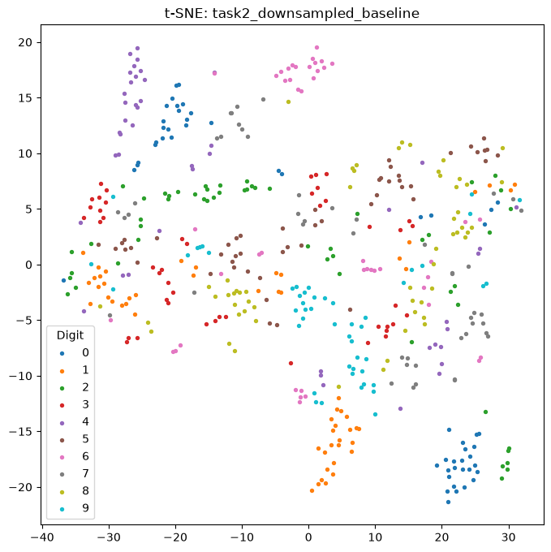
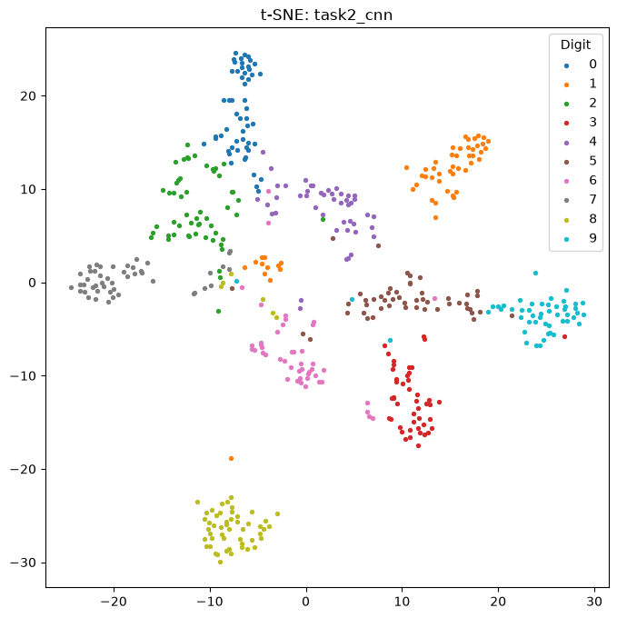
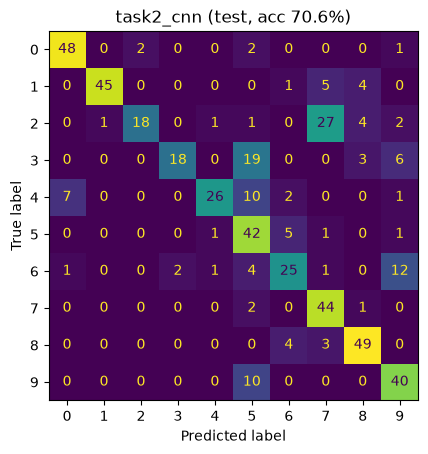
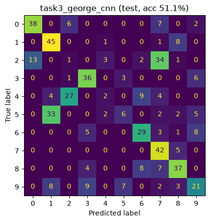

# Speaker-Independent Spoken Digit Recognition (xSDR)

Deep learning models for recognizing spoken digits (0–9) from short audio clips, with a focus on **speaker-independent generalization**: evaluating on speakers the model has never heard during training.

Built with PyTorch on the [Free Spoken Digit Dataset](https://github.com/Jakobovski/free-spoken-digit-dataset) (3,000 recordings, 6 speakers, 8 kHz). Course project for *Neural Networks: Theory and Implementation* (NNTI), Saarland University.

**Credits.** The original course submission (March 2023) was joint work: Zenith Biswas built the Task 1 baseline and wrote the report and presentation, and Enosh wrote most of the Task 2 and Task 3 code. In October 2026, Zenith Biswas fixed that code's bugs and re-implemented it, producing the version and results in this repository.

## Why speaker independence?

Real-world ASR systems must work for speakers they were never trained on. This is especially relevant for low-resource languages, where annotated speech may exist for only one or two speakers. This project simulates that constraint in three steps:

1. **Linear baseline** (`Task1.py`): a linear classifier on fixed-size, downsampled spectrograms.
2. **Multi-speaker training** (`Task2.py`): sequence models trained on the 4 TRAIN speakers, evaluated on 2 unseen DEV/TEST speakers.
3. **Single-speaker training** (`Task3.py`): train on *one* speaker only ("george") and test on the same 2 unseen speakers, using data augmentation and contrastive learning to try to close the gap.

## Data

3,000 clips of the digits 0–9, recorded at 8 kHz (`speech_data/`, listed in `SDR_metadata.tsv`).

| Split | Speakers | Clips |
|---|---|---|
| TRAIN | george, jackson, nicolas, theo | 2,000 |
| DEV | lucas, yweweler | 497 |
| TEST | lucas, yweweler | 503 |

## Setup

Python 3.12. CPU builds of PyTorch are enough; a GPU is used automatically if available.

```bash
python3 -m venv .venv
.venv/bin/pip install -r requirements.txt --extra-index-url https://download.pytorch.org/whl/cpu
```

## Running

```bash
.venv/bin/python Task1.py                 # linear baseline on downsampled spectrograms
.venv/bin/python Task2.py                 # CNN and LSTM on full spectrograms + t-SNE
.venv/bin/python Task3.py                 # single speaker (george): augmentation + contrastive
.venv/bin/python Task3.py --experiments cnn_contrastive --positives labels   # supervised contrastive variant
```

Every script takes `--seed` (default 42) and `--help` lists the other options (epochs, patience, learning rate, models or experiments to run).
On a laptop CPU, Task 1 takes under a minute, Task 2 about 20 minutes (mostly the LSTM) and Task 3 about 10 minutes.

Mel spectrograms (and their pitch-shifted versions) are cached in `.cache/` on first use.
Outputs go to `results/`: `results.json` (all accuracies), and per experiment a text report with confusion matrix and per-class scores, confusion-matrix plots, a validation-accuracy curve and a t-SNE plot.

## Code

| File | Contents |
|---|---|
| `preprocessor.py` | Log-mel features (13 bins, 25 ms window, 10 ms hop), feature cache, downsampling, SpecAugment, pitch shift, datasets, padding, contrastive loss |
| `models.py` | 1D temporal CNN, bidirectional LSTM, contrastive projection wrapper |
| `train_utils.py` | Seeding, data splits, training with early stopping, evaluation and reports |
| `post_model_processing.py` | t-SNE of the last non-linear layer |
| `Task1.py`, `Task2.py`, `Task3.py` | One script per task |
| `spoken_digit_recognition_project.ipynb` | Data exploration and the original Task 1 notebook |

### Method notes

- **Variable length input.** The neural models take the full spectrogram (15 to 229 frames). Batches are zero-padded. The CNN uses the mel bins as input channels, convolves over time, masks padded frames after every convolution and averages over the real frames only. The LSTM uses packed sequences. A clip gets the same prediction alone or padded inside a batch.
- **Training.** Adam (lr 1e-3, weight decay 1e-4), batch size 32, up to 50 epochs, early stopping after 10 epochs without DEV improvement, keeping the best DEV epoch.
- **Augmentation** is drawn anew for every sample in every epoch.
  - SpecAugment: 2 frequency masks of up to 3 bins and 2 time masks of up to 10% of the clip.
  - Pitch shift: with probability 0.5, a shift of ±1 to ±4 semitones. The shifted spectrograms are precomputed with `librosa.effects.pitch_shift` and one is picked at random.
- **Contrastive learning.**
  1. Pre-train the CNN encoder with a projection head and a margin-based contrastive loss on L2-normalised embeddings. Each batch holds two augmented views of each clip (SpecAugment and pitch shift).
  2. Positives are either the two views of the same clip (`--positives views`, self-supervised) or all clips of the same digit (`--positives labels`).
  3. Then train only the final layer on the frozen encoder (linear probe).
  4. Finally fine-tune the whole network.

## Results

Accuracy (%), seed 42, one run each. DEV and TEST are both 2 unseen speakers, about 500 clips each, so differences of 2–3 points are within run-to-run noise.

| Task | Experiment | Train speakers | DEV | TEST |
|---|---|---|---|---|
| I | Linear (SGD, log loss), N = 10 | 4 | 44.1 | 46.9 |
| II | CNN | 4 | **72.8** | **70.6** |
| II | BiLSTM | 4 | 66.4 | 68.2 |
| III | CNN | george | **52.9** | **51.1** |
| III | BiLSTM | george | 48.1 | 45.3 |
| III | CNN + SpecAugment | george | 48.5 | 50.1 |
| III | CNN + pitch shift | george | 50.9 | 48.3 |
| III | CNN + both | george | 45.1 | 43.7 |
| III | Contrastive (views), linear probe | george | 23.9 | 22.5 |
| III | Contrastive (views), fine-tuned | george | 44.9 | 43.7 |
| III | Contrastive (labels), linear probe | george | 46.7 | 43.1 |
| III | Contrastive (labels), fine-tuned | george | 48.5 | 44.5 |

<table>
<tr>
<td></td>
<td></td>
</tr>
<tr>
<td align="center">t-SNE of the downsampled baseline features (TEST)</td>
<td align="center">t-SNE of the CNN's last hidden layer (TEST)</td>
</tr>
<tr>
<td></td>
<td></td>
</tr>
<tr>
<td align="center">CNN, 4 training speakers (TEST)</td>
<td align="center">CNN, trained on george only (TEST)</td>
</tr>
</table>

Observations:
- **Neural models beat the linear baseline.** Using the whole sequence takes accuracy from about 45% to about 70%.
- **The CNN separates the digits much more clearly** than the downsampled features do: compare the two t-SNE plots.
- **Most errors are a few digit pairs.** The CNN mistakes 2 for 7 (27 of 54 TEST clips) and 3 for 5. The single-speaker model also mistakes 5 for 1 (33 of 50).
- **The CNN is better and much faster than the LSTM.** It trains in about 4 s per epoch, against about 33 s for the LSTM, on CPU.
- **Both models overfit.** Training loss keeps falling while DEV accuracy peaks around epoch 17–20, which is why early stopping is used.
- **One training speaker costs about 20 points**, compared with training on all four.
- **Neither augmentation nor contrastive pre-training beats the plain single-speaker CNN here.** Augmented runs peak earlier on DEV, so these settings likely make the training data too hard rather than more varied in the right way.
- **Self-supervised contrastive features alone are weak.** The views linear probe reaches only 23%. Using labels as positives is much better.
- **Next steps:** tune the augmentation strength and the pitch range, and average several seeds (`--seed`).

The original notebook's baseline loaded audio at librosa's default 22,050 Hz and computed features as if it were 8 kHz. Loading at 8 kHz raises the same baseline from 36.8 / 40.4 to 44.1 / 46.9. The notebook cells are fixed, but its saved outputs are from the old run until it is re-executed.
